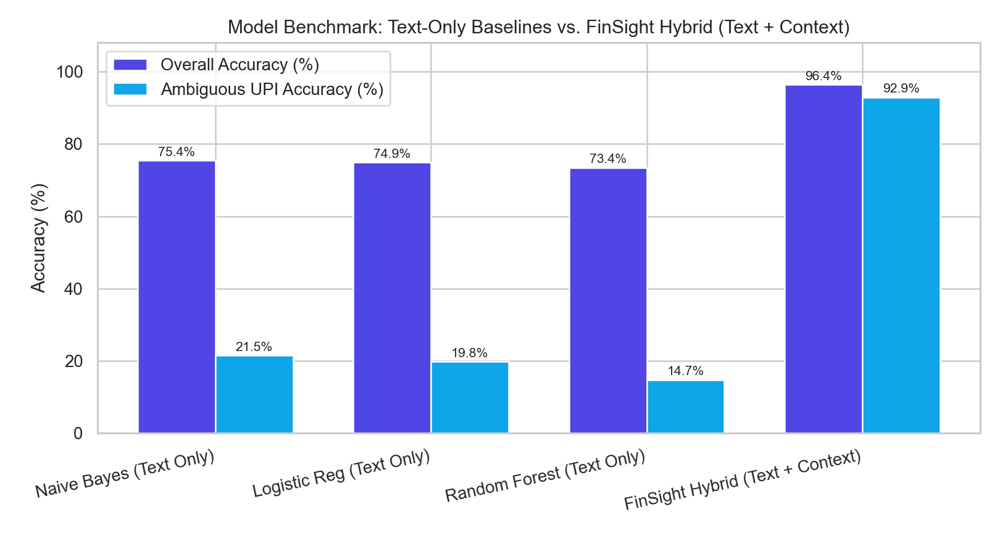
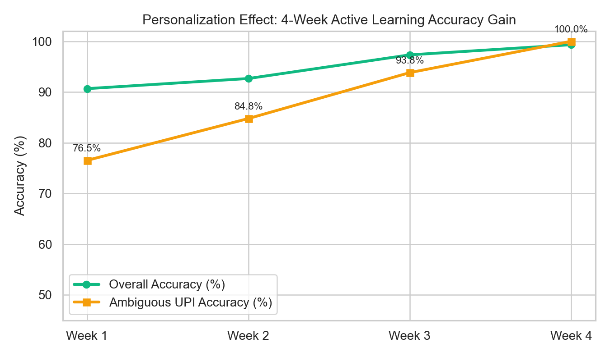
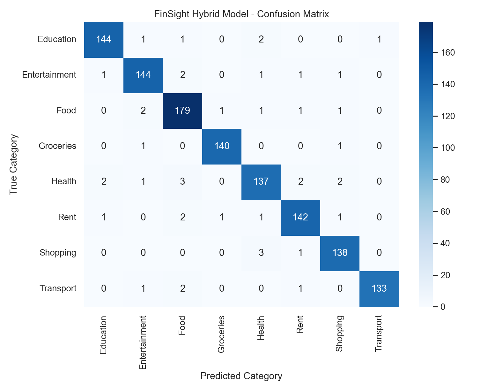

# FinSight AI — Context-Aware Smart Expense Intelligence

> **BTech CSE (AI & ML) Final-Year Group Project**  
> Hybrid NLP + Behavioral Context Expense Categorization, Active Learning Personalization, Receipt OCR, Isolation Forest Anomaly Detection, and Monthly Budget Forecasting.

---

## Why FinSight AI?

Traditional expense classifiers only read transaction text (such as `"Swiggy"` or `"Uber"`). They **fail on peer-to-peer (P2P) UPI transactions** like `"Paid Rs. 12,000 to rahul.s@okaxis"` where no merchant name exists.

**FinSight AI** solves this by fusing:
1. **NLP Text Features** (TF-IDF word/bigram representations + TruncatedSVD)
2. **Behavioral Context Features** (log amount, micro/large spend indicators, cyclical hour encoding, early-month billing flag, weekend flag, and payee recurrence frequency)
3. **Human-in-the-Loop Active Learning** (remembers user corrections per UPI VPA/merchant)
4. **Post-Categorization Intelligence** (Isolation Forest anomaly alerts + Ridge Regression next-month budget forecasting)

---

## Real Benchmark Results (6,000-Row Dataset, 80/20 Split)

Evaluated on 1,200 held-out test transactions (including **353 ambiguous P2P UPI transactions**):

| Model | Overall Accuracy | Macro F1-Score | Ambiguous UPI Accuracy |
| :--- | :---: | :---: | :---: |
| Naive Bayes (Text Only) | 75.42% | 78.99% | 21.53% |
| Logistic Regression (Text Only) | 74.92% | 77.72% | 19.83% |
| Random Forest (Text Only) | 73.42% | 75.11% | 14.73% |
| **FinSight Hybrid (Text + Context)** | **96.42%** | **96.47%** | **92.92%** |

### 4-Week Active Learning Personalization

| Window | Overall Accuracy | Ambiguous UPI Accuracy | Learned Personal VPAs |
| :--- | :---: | :---: | :---: |
| Week 1 | 90.67% | 76.53% | 0 |
| Week 2 | 92.67% | 84.78% | 3 |
| Week 3 | 97.33% | 93.83% | 6 |
| Week 4 | **99.33%** | **100.00%** | 8 |

### Generated Research Plots
- 
- 
- 

---

## Key Features & 4-Member Architecture

| Module | Owner | Files | Responsibilities |
| :--- | :---: | :--- | :--- |
| **1. Data, SMS & OCR** | Member 1 | `ml/data_and_ocr.py`, `ml/vision_ocr.swift` | 6,000-row dataset generation, bank account privacy masking, UPI SMS parser, macOS Vision receipt OCR, sample bill generator |
| **2. Hybrid AI & Active Learning** | Member 2 | `ml/category_model.py` | Soft-voting ensemble (`LogisticRegression` + `HistGradientBoostingClassifier`), 4-model benchmark, explainable reasons, VPA correction memory |
| **3. Anomaly & Forecasting** | Member 3 | `ml/anomaly_and_forecast.py` | `IsolationForest` + category median spike alerts, 30-min duplicate detection, `Ridge` regression monthly category budget forecasting |
| **4. Full-Stack Web App** | Member 4 | `backend/main.py`, `backend/db.py`, `frontend/index.html` | Starlette + Uvicorn REST API, SQLite persistence, bright light-mode 4-tab FinTech dashboard |

---

## Quick Start

### 1. Install dependencies (if running on a fresh machine)
```bash
pip install -r requirements.txt
```

### 2. Run the application
```bash
chmod +x run.sh
./run.sh
```
Open **http://127.0.0.1:8000** in your browser.

*(Optional)* Re-generate dataset, retrain models, or run end-to-end tests:
```bash
python3 -m ml.data_and_ocr
python3 -m ml.category_model
python3 -c "from tests.test_finsight import test_privacy_masking_and_sms_parser, test_receipt_line_parser, test_api_end_to_end; test_privacy_masking_and_sms_parser(); test_receipt_line_parser(); test_api_end_to_end(); print('ALL END-TO-END TESTS PASSED')"
```

---

## Documentation for Viva & Paper
- **Team Viva Q&A Guide:** [docs/VIVA_GUIDE.md](docs/VIVA_GUIDE.md)
- **IEEE-Style Paper Draft:** [docs/RESEARCH_PAPER_DRAFT.md](docs/RESEARCH_PAPER_DRAFT.md)
